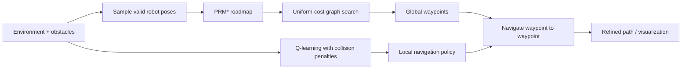
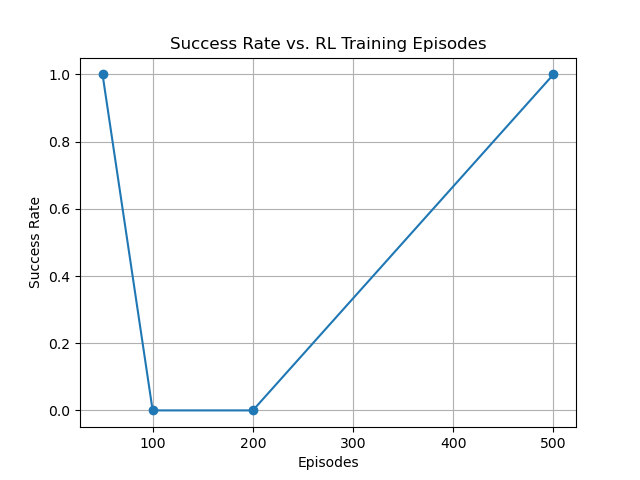
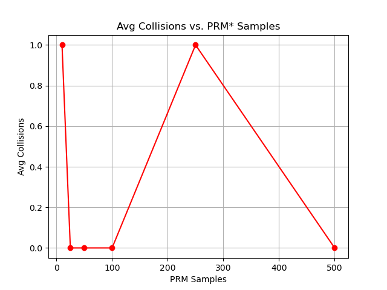
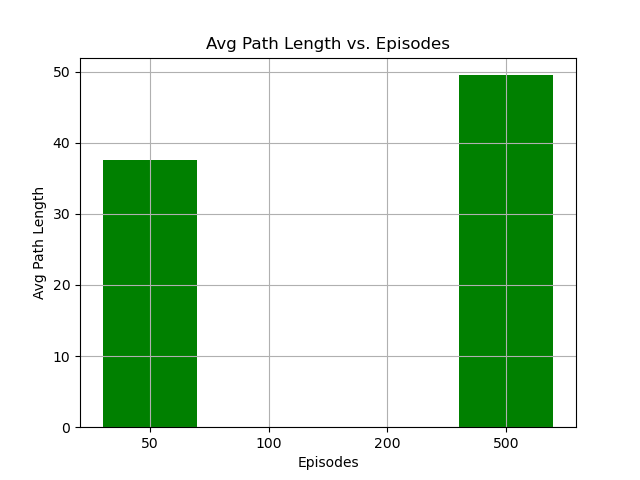
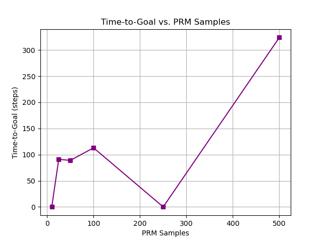

# Hybrid Motion Planning: PRM* + Q-Learning

**Sampling-based global planning, reinforcement-learning-based local navigation, and experimental evaluation in simulated robot environments.**

This repository explores how to combine a global motion planner with a learned local controller. Rather than asking reinforcement learning to discover an entire route from scratch, the hybrid approach first creates a collision-aware roadmap and then uses Q-learning to navigate between successive subgoals.

The repository also contains standalone implementations of **RRT**, **PRM**, collision checking, visualization, and ablation experiments.

## Approach



### 1. Global planning

The PRM* implementation samples collision-free configurations, identifies nearby states, checks candidate connections for collisions, and builds a weighted roadmap. The implementation uses a `ProcessPoolExecutor` to evaluate candidate edges in parallel.

Uniform-cost search then selects a route through the roadmap from the starting configuration to the goal.

### 2. Local policy learning

The Q-learning agent uses a discretized state representation, an epsilon-greedy action strategy, and rewards/penalties influenced by progress, collisions, and repeated behavior. After training, the policy attempts to navigate between subgoals along the global roadmap.

### 3. Evaluation

`experiments.py` varies training episodes and roadmap sample counts, recording metrics including:

- Navigation success rate
- Collision / failed-subgoal count
- Average path length
- Steps taken to reach the goal

The following plots are checked into the repository as experimental artifacts. They are included for illustration; their values have **not** been rerun or independently validated as part of this README update.

| Success vs. training episodes | Collisions vs. PRM* samples |
| :---: | :---: |
|  |  |

| Path length vs. training episodes | Time to goal vs. PRM* samples |
| :---: | :---: |
|  |  |

## Repository guide

| File | Purpose |
| --- | --- |
| `integrated_prm_rl.py` | Combined PRM* + Q-learning workflow |
| `ao_planner.py` | Parallelized PRM* roadmap planner |
| `prm.py` | PRM implementations |
| `rrt.py` | Rapidly exploring random tree (RRT) |
| `rl_path_planner.py` | Standalone Q-learning-based path planner |
| `experiments.py` | Ablation studies and evaluation plots |
| `collision_checking.py` | Collision-checking and visualization utilities |
| `component_1.py`, `utils.py`, `hw3utils.py` | Robot/environment models and supporting functions |
| `0.txt`–`6.txt` | Example environment maps |

## Getting started

This is a **research/prototype codebase**, not a packaged Python library. It has no pinned dependency file or automated test suite yet, and the following commands are based on the source entry points rather than a freshly verified installation.

### Install

```bash
git clone https://github.com/vriishin/robotics-motion-planning.git
cd robotics-motion-planning

python3 -m venv .venv
source .venv/bin/activate   # Windows: .venv\Scripts\activate
pip install numpy matplotlib
```

Other packages may be required for some visualization or experiment paths. If you encounter an import error, consult the corresponding module and install its dependency.

### Run the hybrid planner

The main script accepts a robot type, map, starting pose, and target pose:

```bash
python integrated_prm_rl.py \
  --robot car \
  --map 0.txt \
  --start 0 0 0 \
  --goal 5 5 0
```

**Example arguments only:** Adjust the start and goal to collision-free poses supported by your chosen map. Coordinates and heading are in the form `x y theta` for a car-like robot. The script constructs a PRM* roadmap, runs graph search, trains the Q-learning agent, and displays the resulting path if a route is found.

You can also inspect the independent planning implementations, for example:

```bash
python ao_planner.py --robot car --map 0.txt --start 0 0 0 --goal 5 5 0

python rrt.py --robot car --map 0.txt --start 0 0 0 --goal 5 5 0
```

The experimental runner uses the same argument pattern:

```bash
python experiments.py --robot car --map 0.txt --start 0 0 0 --goal 5 5 0
```

> The experiments may be computationally expensive. Some scripts generate animations and expect output directories or external tools such as FFmpeg to be available.

## Design decisions and tradeoffs

**Why combine PRM* and RL?** The roadmap provides global structure; local policy learning can then focus on shorter navigation tasks. This separates long-horizon graph search from local control decisions.

**Why parallelize roadmap construction?** Checking candidate edges for collisions can be expensive. Evaluating those edges in separate processes provides an opportunity to reduce roadmap-building time, at the cost of worker startup and interprocess overhead.

**Why run ablations?** Varying roadmap density and the number of Q-learning episodes helps distinguish whether performance changes are due to the global graph or the local policy.

## Known limitations

- The Q-learning transition/action logic in the integrated implementation is primarily tailored to the **car** case; the arm workflow requires additional work for equivalent end-to-end support.
- State-space discretization can be memory-intensive and does not generalize cleanly to continuous, high-dimensional control.
- Several parameters, map assumptions, and output paths are hard-coded.
- Experiments lack fixed random seeds, environment pinning, and automated regression tests.
- Previously generated plots do not by themselves establish reproducible performance claims.

## Next improvements

- Add a reproducible environment (`requirements.txt` or `pyproject.toml`) and a known-good example map/pose pair.
- Make experiment configuration explicit and deterministic.
- Add unit tests for collision detection, graph construction, and route validity.
- Introduce clearer success/failure reporting and stronger baseline comparisons.
- Refactor source, maps, figures, and generated artifacts into separate directories.

---

*An exploratory robotics project focused on implementing, integrating, and evaluating classical planning methods and reinforcement learning.*